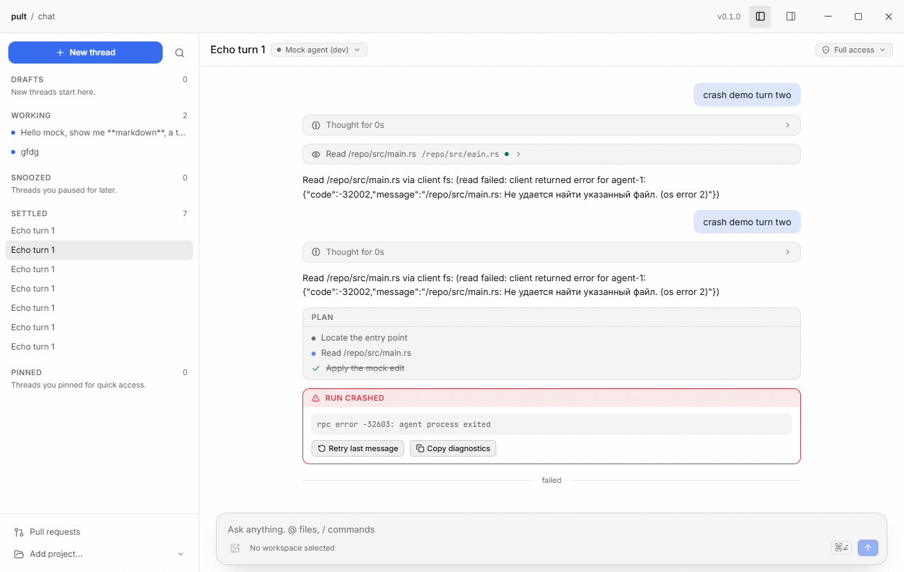
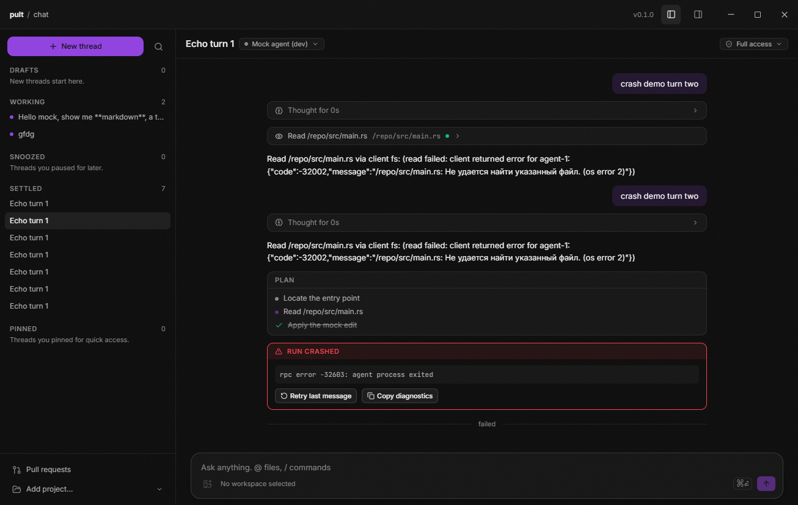
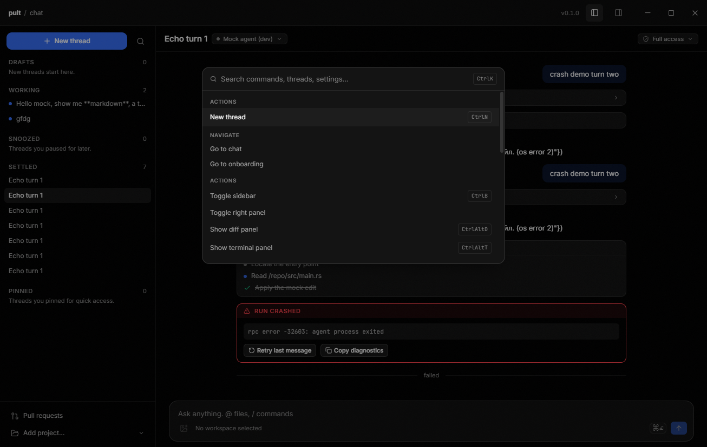
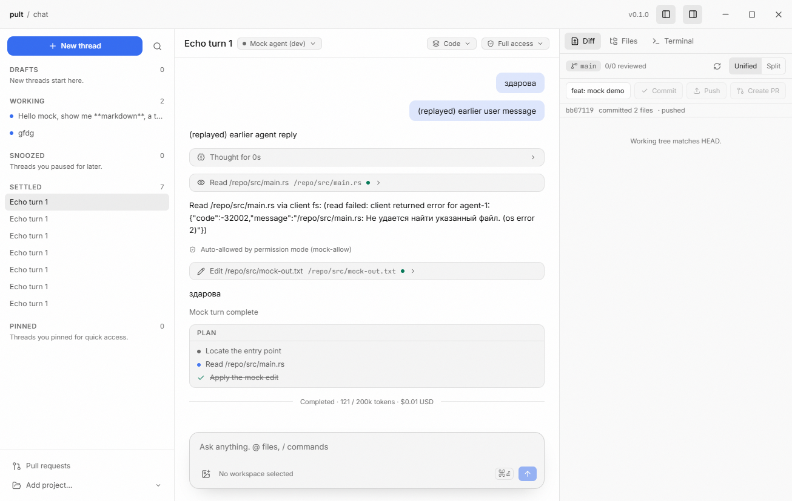
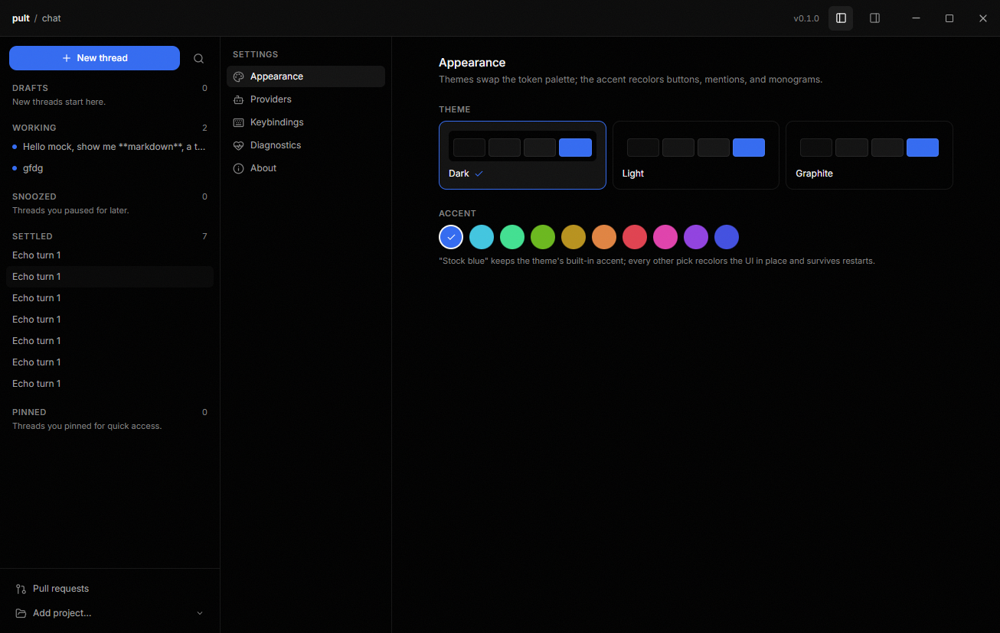

# pult

A local-first **Agent Development Environment** over ACP: one desktop app that hosts your
coding agents (Claude Code, Gemini CLI, Codex, dsh — anything speaking the Agent Client
Protocol) in one place. Bring your own subscription; pult is not an agent and holds no API
keys.


## What it does

- **Agents over ACP** — spawn any ACP-speaking CLI (`command + args` in `~/.pult/config.toml`),
  detect installed ones in the onboarding wizard, run the bundled mock agent for development.
- **Streaming chat** — thoughts, tool calls, plans, diffs, approvals; queued messages while a
  turn runs; permission modes (Supervised / Auto edit / Auto / Full access) with one-keystroke
  approvals (`A` / `S` / `D`).
- **Git built in** — live diff per thread (scratch-index diffing is byte-exact and never
  touches your real index), per-file review checkboxes, one-click Commit ▸ Push ▸ Create PR
  (via `gh`), isolated worktrees per thread, hidden checkpoint refs per run.
- **Terminals** — real ConPTY per thread in xterm.js; agent-opened terminals mirror into the
  panel.
- **Sessions persist** — transcripts in sqlite (`~/.pult/pult.db`), resume via `session/load`,
  JSONL-exportable; agents can crash and pult tells you with a recovery path, not a blank
  screen.

|                                                         |                                                               |
| ------------------------------------------------------- | ------------------------------------------------------------- |
|                |  |
|         |                 |
|  |                                                               |

## Quick start

```sh
pnpm install
pnpm tauri dev   # full desktop app (Rust core + UI)
pnpm dev         # UI only, in a browser (no IPC bridge)
```

Verification:

```sh
pnpm typecheck && pnpm lint && pnpm test      # vitest; Playwright smoke: pnpm exec playwright test
cargo clippy --manifest-path src-tauri/Cargo.toml --all-targets -- -D warnings
cargo test --manifest-path src-tauri/Cargo.toml
```

## Configuration

`~/.pult/config.toml` — the agent matrix source of truth:

```toml
[[instances]]
id = "claude-code"
displayName = "Claude Code"
driver = "acp"                       # "mock" for the built-in dev agent
command = "npx"
args = ["-y", "@zed-industries/claude-code-acp"]

[instances.env]                      # per-instance environment
MOCK_SLOW_TURN = "1"
```

Everything else lives in the sqlite settings table (`~/.pult/pult.db`): theme, accent,
permission mode, keybindings — editable in Settings → Appearance / Keybindings.

## Themes

Dark (default), Light, and Graphite are pure token-block overrides
(`src/styles/tokens.css` + `src/styles/themes/`). The accent hue picker regenerates
accent/mention/monogram tokens via HSL. A test suite (`tests/theme-contrast.test.ts`)
enforces WCAG ≥ 4.5:1 for every text pair in all three themes.

## Keyboard

`Ctrl/Cmd+K` command palette · `Ctrl/Cmd+N` new thread · `Ctrl/Cmd+B` sidebar ·
`Ctrl/Cmd+Alt+D` diff panel · `Ctrl/Cmd+Alt+T` terminal panel · Enter send · Esc stop ·
`A/S/D` approval answers. Rebindable in Settings → Keybindings.

## Building & distribution

```sh
pnpm tauri build   # release bundle: NSIS installer (Windows), dmg (macOS), deb/AppImage (Linux)
```

Per-OS bundling is configured in `src-tauri/tauri.conf.json` (`bundle.targets: "all"`,
`createUpdaterArtifacts: true`). Windows code signing is not configured in-repo — set
`TAURI_SIGNING_PRIVATE_KEY` / matching vars in CI as usual for Tauri apps.

### Updates

The updater plugin is wired (`tauri-plugin-updater`) but inert until you point it somewhere:

1. Signing keys: the repo ships with a **dev keypair** — the public key is in
   `tauri.conf.json`, the private key lives outside the repo at `~/.tauri/pult.key`
   (empty passphrase). For production, generate your own:
   `pnpm tauri signer generate -w ~/.tauri/pult.key` and replace the `pubkey` in
   `tauri.conf.json`.
2. Host update manifests at your endpoint and put its URL into `plugins.updater.endpoints`
   (currently a placeholder domain, `releases.pult.local`).
3. Sign release artifacts by setting `TAURI_SIGNING_PRIVATE_KEY` (path or contents of the
   private key) when running `pnpm tauri build` — the bundler then emits `.sig` updater
   artifacts alongside the installers. The private key never leaves your machine; pult
   itself holds nothing but the public key.

While the endpoint is the placeholder, the app runs normally; nothing calls the updater at
startup.

### macOS first-run notes

macOS Gatekeeper will warn about unsigned/ad-hoc builds ("pult is an app downloaded from the
internet"). Right-click → Open bypasses it for local builds; distribution builds should be
signed and notarized (`codesign` + `xcrun notarytool`) — CI territory, not wired here.

## Project layout

```
src/                 React frontend (routes, stores, components; zustand + tanstack router)
src-tauri/           Rust core (tauri 2): protocol/, drivers/, runtime/, store/, git/, ipc/
protocol/            pinned ACP JSON schema (authoritative; codegen/tests read it)
fixtures/            mock ACP agent, fixture repo + bare remote, mock gh
docs/screenshots/    the images above
DEVLOG.md            one entry per milestone: decisions, deviations, known issues
```

## Status

Milestones M0–M8 complete; see [DEVLOG.md](DEVLOG.md) and [CHANGELOG.md](CHANGELOG.md).
Known environment limitations (real Claude Code / Gemini CLI not installed on the dev
machine) are recorded per milestone in the DEVLOG.
