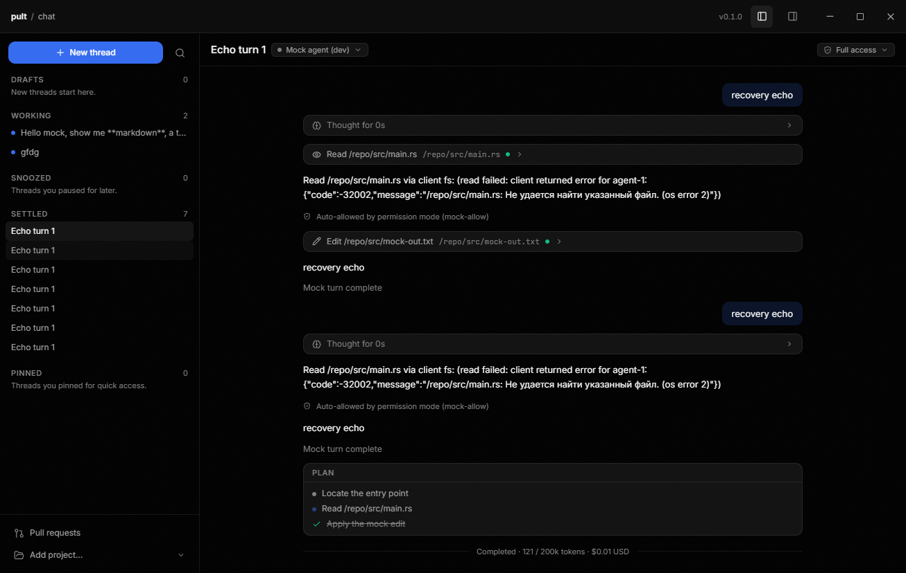

# Pult

**A local-first Agent Development Environment.** One desktop workspace for the coding
agents already on your computer — Codex, Claude Code, Gemini/Antigravity, opencode and
anything else that speaks the Agent Client Protocol (ACP).

Bring your own subscription. Pult is not an agent, stores no API keys, and keeps every
chat in a local SQLite database.



## Download

Grab the latest Windows installer from
[GitHub Releases](https://github.com/tamrazcode/Pult/releases/latest):

- **Windows** — `pult_<version>_x64-setup.exe` (NSIS)
- macOS / Linux builds are not published yet.

A clean install starts with a four-step onboarding: detect agents on the machine, connect
the ones you want, tour git/worktrees + browser + terminal, then create a **local profile**
(avatar, nickname, `@handle`).

## What it does

- **Agents over ACP** — add any ACP CLI as `command + args`; Pult detects installed
  agents, runs them side by side, and keeps each thread's session alive.
- **Streaming chat** — thoughts, tool calls, plans, diffs and approvals. Consecutive
  tools/thoughts fold into one smart activity row that shows the current action and
  elapsed time; expanding reveals readable file excerpts, commands and diffs.
- **Git built in** — live per-thread diff, per-file review, commit → push → PR, isolated
  worktrees, hidden checkpoints per run.
- **Real terminal** — ConPTY per thread (xterm.js), plus terminals the agent opens.
- **Built-in browser** — a native child webview, not an iframe: any site opens regardless
  of `X-Frame-Options`/CSP, and local HTML/JS/CSS works from a token-scoped loopback
  server.
- **Queue & steering** — keep typing while an agent runs; queued messages can be edited
  in the composer, reordered by dragging, or sent immediately with Steer.
- **Seven languages** — English (default), Russian, German, Spanish, Japanese, Chinese and
  French, switchable without restart.
- **Light / dark / graphite / liquid themes**, a living ASCII backdrop, and a Full access
  mode that is unmistakably orange.
- **Local profile & plugins** — a customizable profile card and a declarative plugin
  folder (`~/.pult/plugins`) for commands, slots and themes.
- **Background notifications** — native toast + soft chime when a run finishes or fails
  while Pult is in the background; both switchable in Settings → Chat.

| Dark                                    | Light                                     |
| --------------------------------------- | ----------------------------------------- |
|  |  |

| Graphite accent                                        | Command palette                                  |
| ------------------------------------------------------ | ------------------------------------------------ |
|  |  |

| Diff panel                               | Appearance settings                                     |
| ---------------------------------------- | ------------------------------------------------------- |
|  |  |

## Build from source

Prerequisites: Node 22+, pnpm 10+, Rust stable, and the Tauri system dependencies for
your OS.

```sh
pnpm install
pnpm tauri dev      # desktop app (Rust core + UI)
pnpm dev            # UI only in a browser (no IPC bridge)
```

Verification:

```sh
pnpm typecheck
pnpm lint
pnpm test
pnpm exec playwright test
cargo test --lib --manifest-path src-tauri/Cargo.toml
cargo clippy --all-targets --manifest-path src-tauri/Cargo.toml -- -D warnings
```

## Configuration

`~/.pult/config.toml` is the agent matrix. Add an instance with its command and args:

```toml
[[instances]]
id = "codex"
display_name = "Codex"
driver = "codex-acp"
command = "codex-acp"
args = []
enabled = true
```

Runtime data lives outside the app bundle:

```
~/.pult/pult.db      chats, runs, settings, local profile
~/.pult/plugins/     declarative plugins (see docs/PLUGINS.md)
~/.pult/config.toml  provider instances
```

## Updates

Pult checks GitHub Releases for updates in the background and on demand from the footer
button. When a release is available it shows a badge, downloads with a determinate
progress ring, installs silently and restarts. Release artifacts are signed with the
Tauri updater key; see [docs/RELEASING.md](docs/RELEASING.md).

## Documentation

- [docs/PLUGINS.md](docs/PLUGINS.md) — plugin manifest and security model
- [docs/RELEASING.md](docs/RELEASING.md) — NSIS build, GitHub release, updater signing
- [CONTRIBUTING.md](CONTRIBUTING.md) — dev workflow and checks
- [SECURITY.md](SECURITY.md) — reporting a vulnerability
- [CHANGELOG.md](CHANGELOG.md) — what changed

## License

MIT — see [LICENSE](LICENSE).
